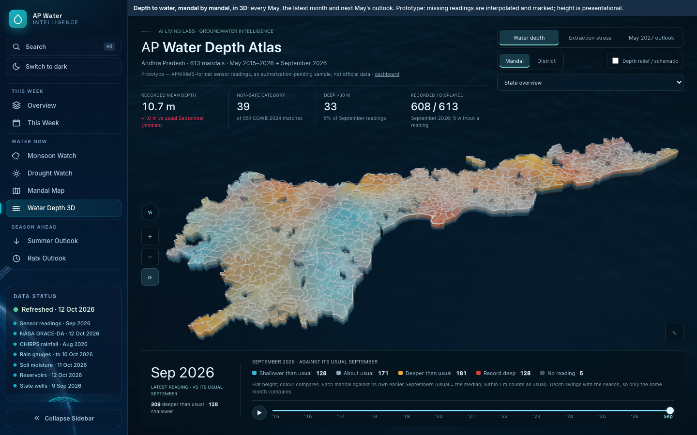
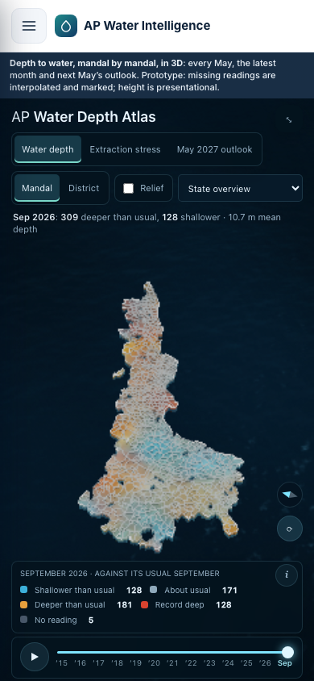
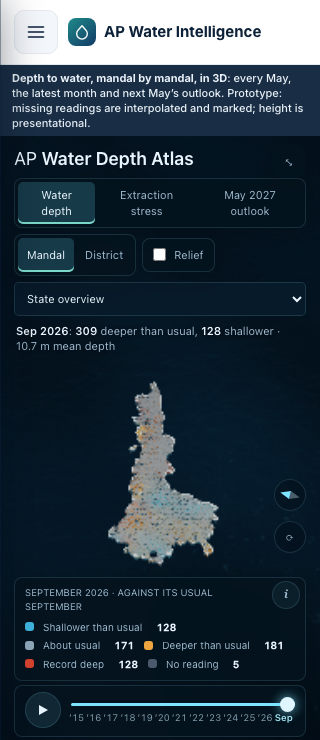

# Water Depth 3D atlas polish

October 13, 2026. Presentation and interaction changes only; the embedded `GW`
data is unchanged from `origin/main` at `0ec69d6`.

## Changes

- One bottom reading dock combines the date, colour key and timeline.
- The comparison chart appears with a selected place instead of duplicating the
  default state summary. Recorded values and source links remain available.
- The camera fits the actual state outline between the top controls and bottom
  dock. Mandal boundaries and colours are clearer after reducing bloom, glare
  and background ripple contrast. Automatic rotation is off; drag, zoom, reset,
  timeline animation and schematic depth relief remain.
- Phone layouts retain a compact legend including missing readings, touch
  controls, pinch zoom, and a closable detail sheet. This is mobile adaptation,
  not a compressed desktop layout.
- Depth, missing observations and the next-May projection remain distinct.
  Prototype and presentational-height caveats remain visible.

## Verification

All 13 atlas Playwright tests passed against the production static export.
Screenshots cover 1280, 1440 and 1920px desktop widths, plus 320, 390 and 430px
touch-emulated phones. Tests cover framing, overflow, nonblank/moving canvas
pixels, pinch zoom, selection, close/reset controls, relief, district means and
projection modes. This is Chromium emulation, not physical iPhone/Safari testing.

## Screenshots

