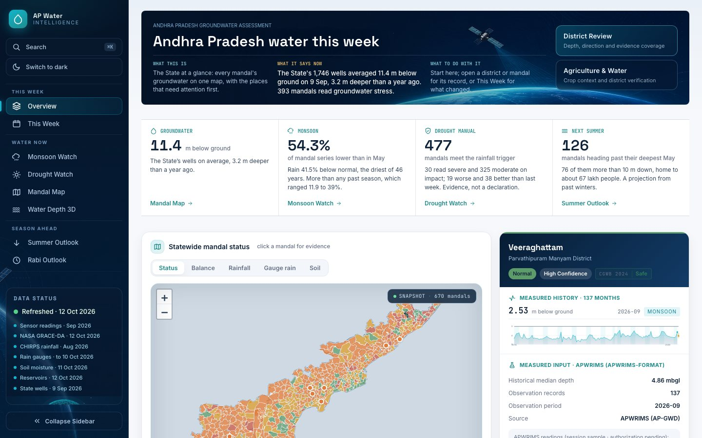
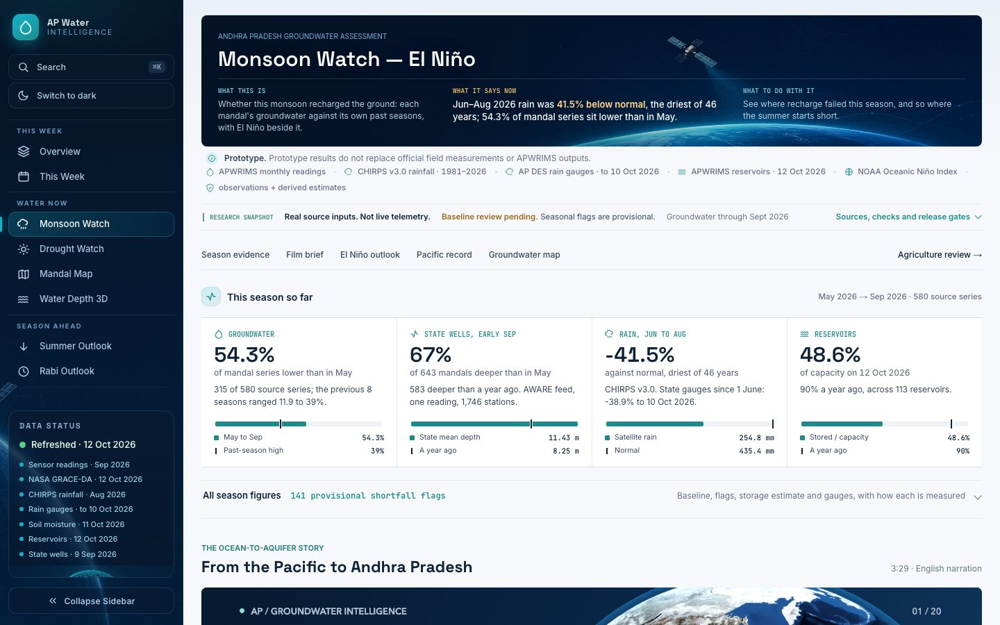
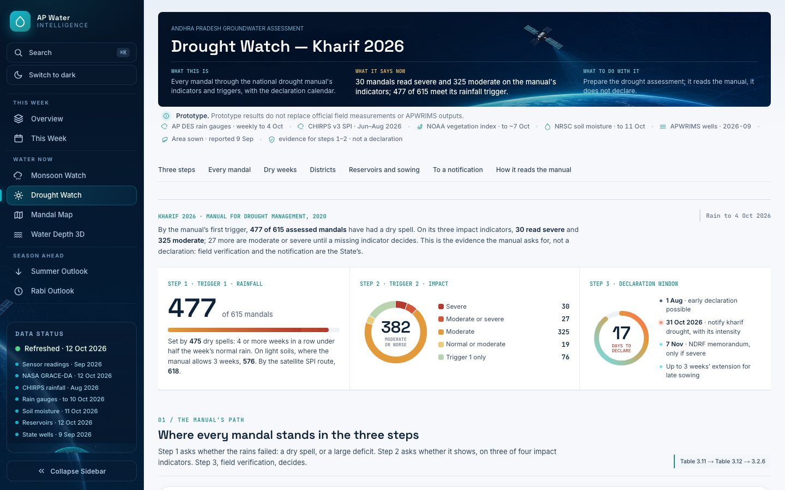
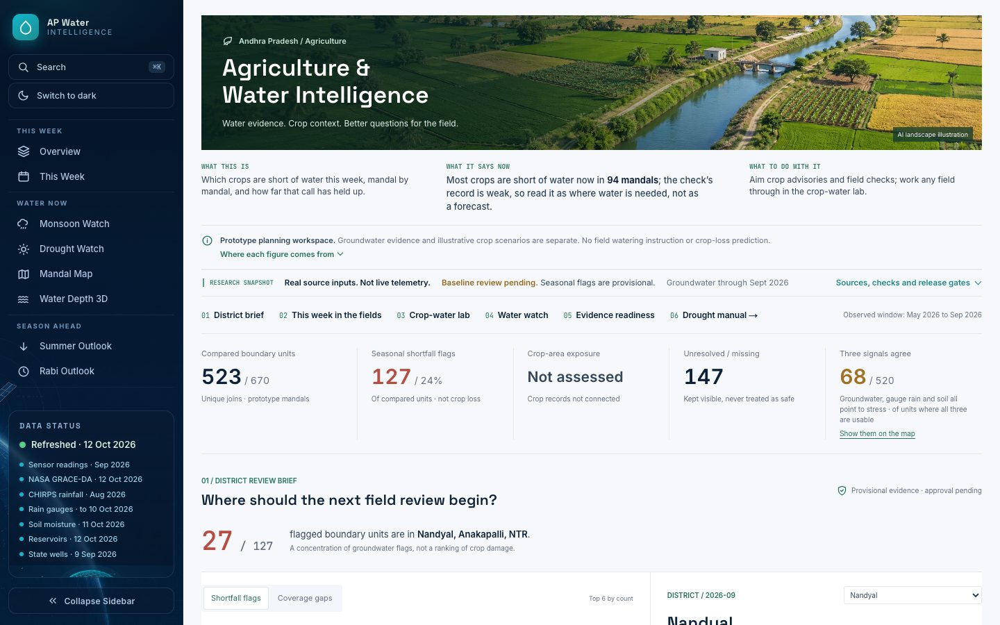
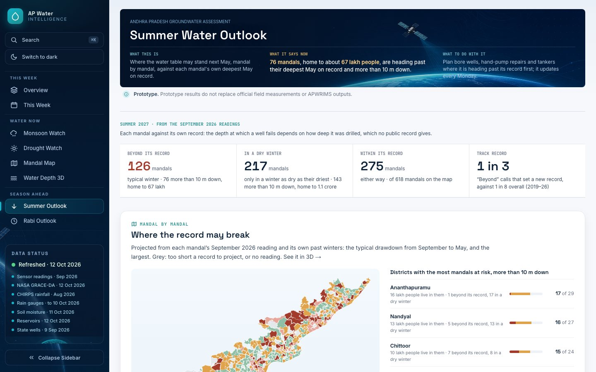
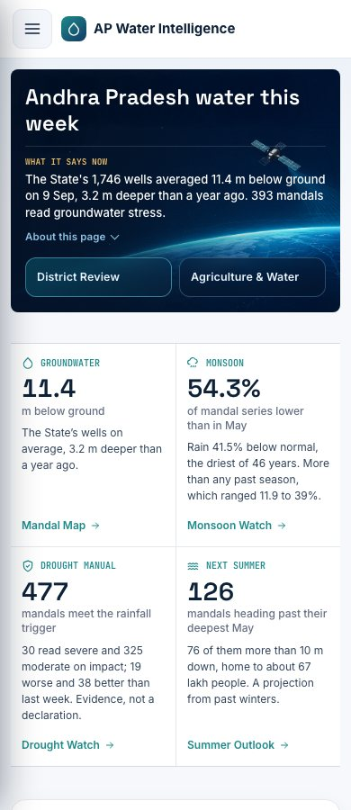
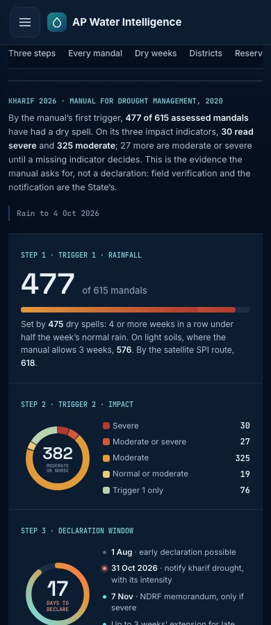
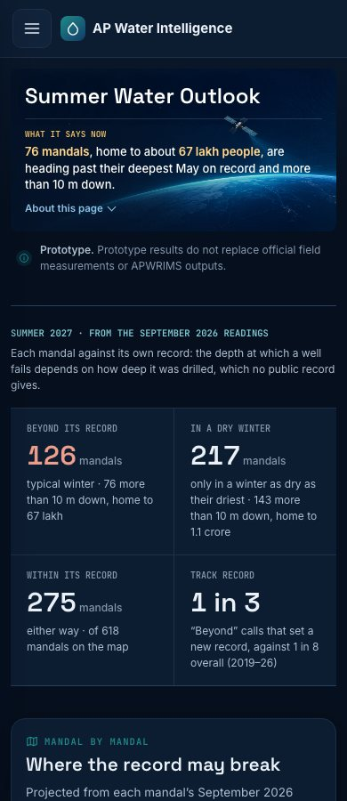

# Main-screen visual review

Scope: Overview, Monsoon, Agriculture, Drought, Summer, Mandal Map, Watchlist and Readiness. Desktop screenshots use 1440 x 900; phone screenshots use 390 x 900. Automated evidence-layout checks also cover 320 px and both themes.

## Changes

- Compact shared header, preserving satellite artwork, page brief, prototype notice and phone disclosure.
- Overview and Monsoon use a continuous evidence strip instead of separate floating headline cards. Overview pairs its figures on larger phones.
- Monsoon adds zero-based comparison bars for seasonal groundwater, the State well mean, satellite rainfall and reservoir storage. Reference labels distinguish a past-season high, year-ago reading and normal; they are not targets.
- Rainfall summaries retain source precision and Monsoon's header derives its month window from the dataset instead of hard-coding June-August.
- Agriculture retains its landscape and crop-water workspace. Its secondary brief is a light/theme-aware information band rather than a second dark hero.
- Drought retains all three manual steps, counts, uncertainty categories and deadline. The summary is one theme-aware surface, with no nested cards.
- Summer retains the projection and track record together in a compact evidence strip, without the brown hero panel.
- Map, Watchlist and Readiness receive the shared header refinement; their detailed workspaces are preserved.

## Evidence retained

No source data, model logic, film assets, geometry or Crystal atlas files were changed. The film source-hash check still matches current inputs. Data remains a dated research snapshot, not live telemetry or a government-approved operational service.

## Verification

- Production static build: 878 routes.
- Python integrity suite: 467 passed.
- Focused browser checks: 54 passed.
- Wider browser suite excluding the unchanged Crystal-specific suite: 220 passed initially, five timed out on animated controls/video. All five passed in a separate unchanged-test run (21.2 seconds). The initial full run was not clean.
- Film source snapshot: matches current app data and site tokens.
- Eight-page screenshot audit: no page errors or horizontal overflow at 1440 px and 390 px.

## Captures

The viewport capture receipt is in `viewports.json`. Browser emulation does not replace physical-device testing.
