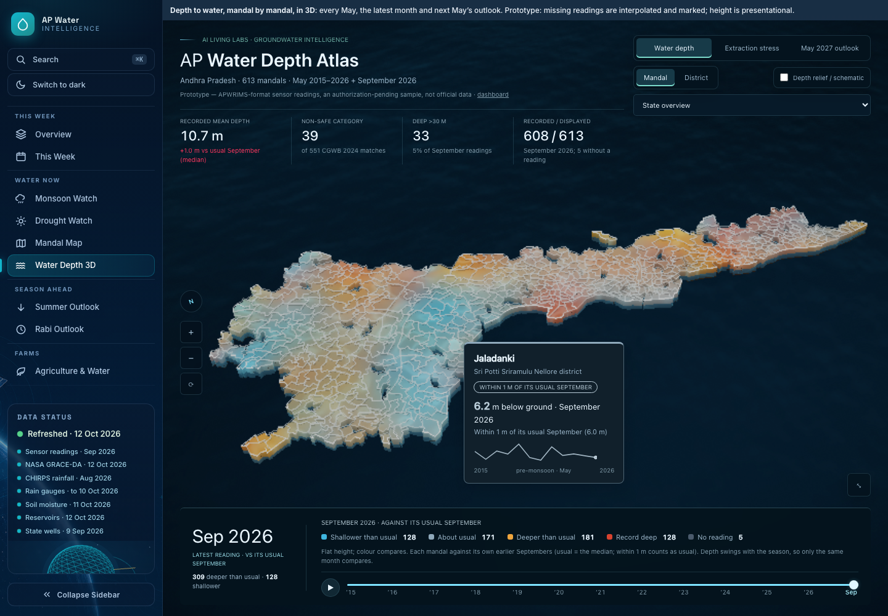
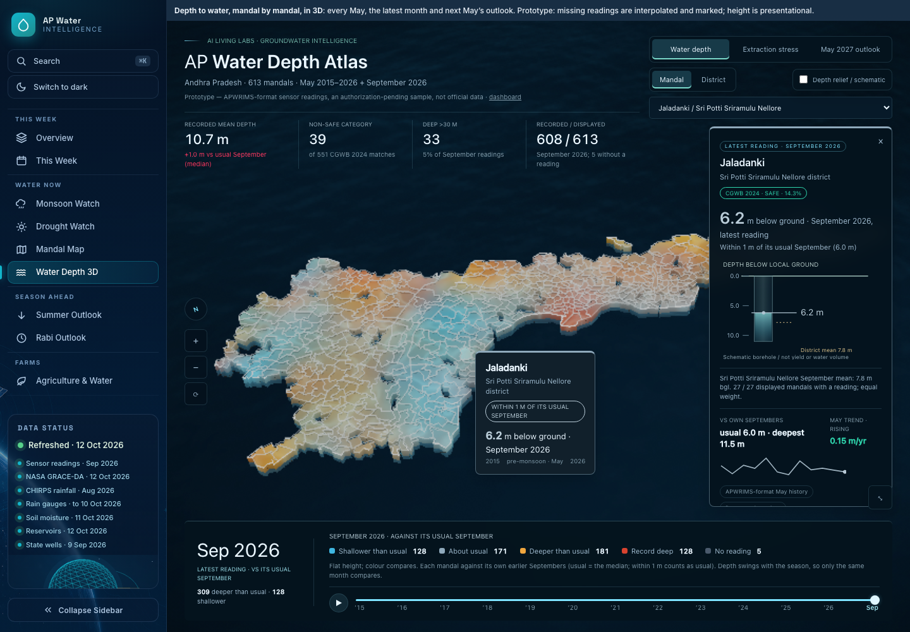
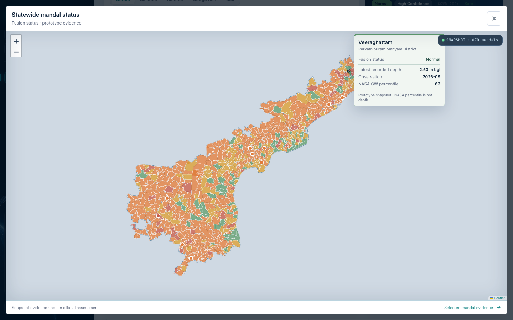
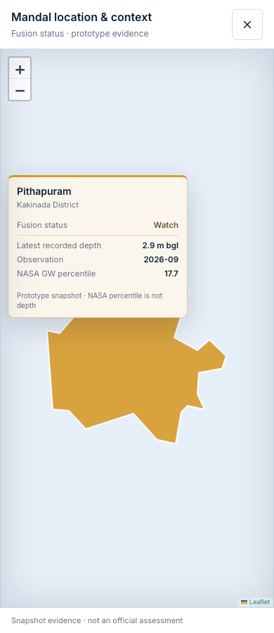

# Map hover consistency review

## Behaviour

- Map cards take their border and a restrained surface tint from the same colour calculation as the hovered feature, including active-layer and theme changes.
- Primary readings use a contrast-adjusted version of that colour. Independent measurements, comparison baselines, and deeper/shallower indicators retain their own meaning.
- The AP Water Depth Atlas reads its current scene colour buffer, so cards follow the selected year, latest-month comparison, extraction category, district aggregation, and summer outlook. Its hover sparkline, selected mandal trend, well-depth marker and selected panel also follow that accent.
- Overview and mandal-detail maps use the same compact summary: identity, active layer, latest recorded depth, observation period, NASA groundwater percentile, and prototype caveat. Full evidence remains in the detail panel/page. No data was removed from the application.
- Both maps can expand into a native modal dialog. The selected layer and mandal persist; the expanded Overview links to selected evidence. Escape/close returns focus to the expand button, with no background scroll.
- The mandal detail map grows from 220 to 300 pixels. Hover cards are constrained to the map viewport; the statewide spotlight mask is not drawn at a single-mandal zoom, where its simplified edges created distracting slivers.

## Data safeguards

No data files, forecasts, classification thresholds, or aggregation rules change. A colour is a cue for the selected layer, not a reclassification of every value in a card. NASA percentiles remain separate from measured depth. Forecast and baseline series remain distinguishable.

## Verification

- `PAGES_BASE_PATH= npm run build:static`: passed, 878 routes.
- `python3 -m pytest -q`: 467 passed.
- Playwright map tints, Crystal, water context, outlook, weekly design and agriculture map projects: 50 passed.

Automated checks in `app/e2e/governance-map-tints.spec.ts` cover active-layer colours in both themes, open-card updates, Leaflet district/mandal maps, the Atlas colour buffer and real raycast hover, and mobile/desktop expansion with focus restoration and clipping assertions.

The regression run also includes the Atlas canvas-pixel/motion tests, touch interaction, groundwater/outlook guardrails, This Week layouts, and agriculture map interaction. Screenshots in this folder show the final local production build, not mockups.

