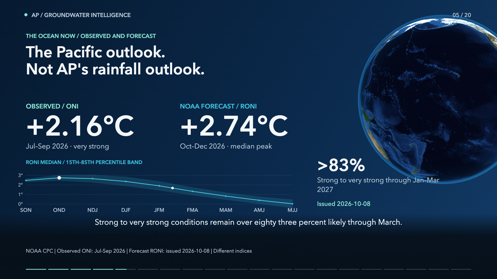
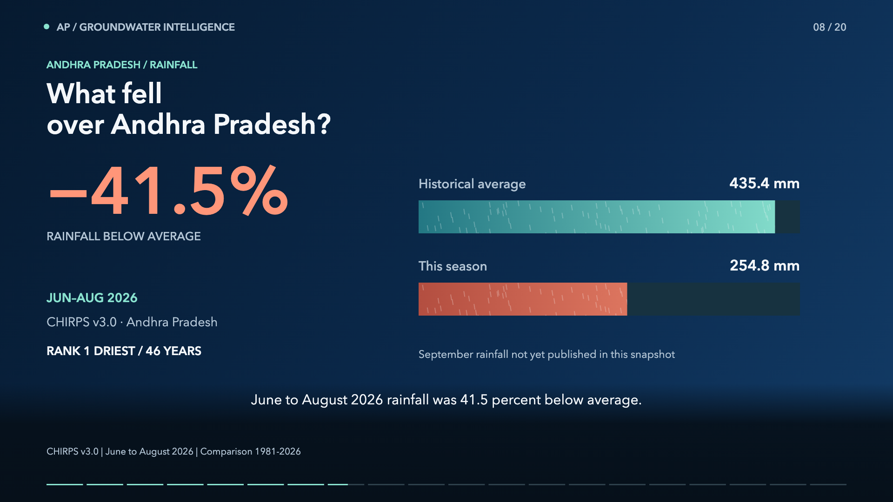
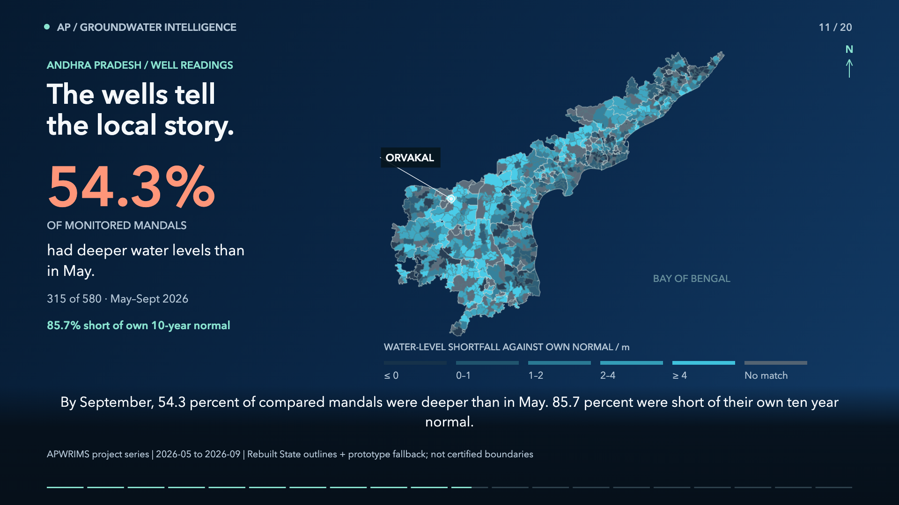
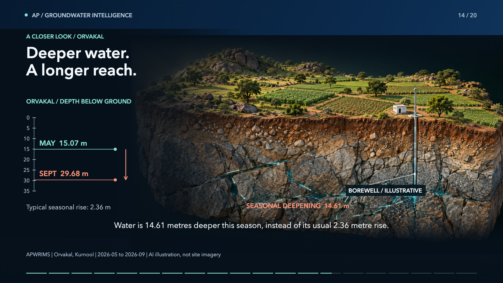
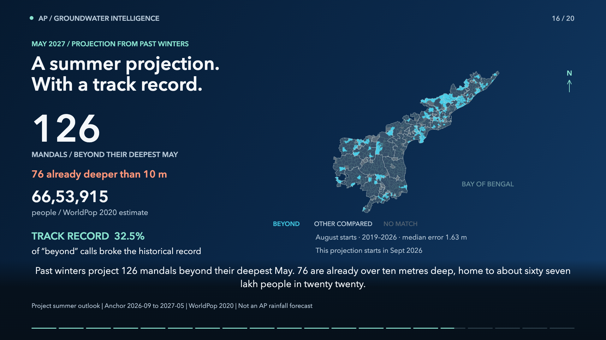
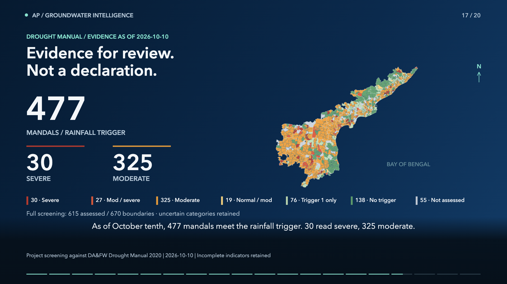
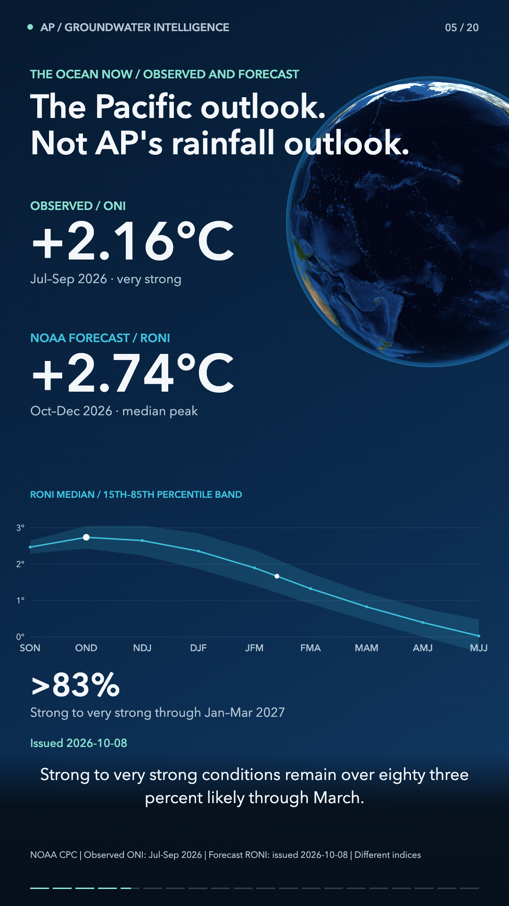

# October 2026 film review

**English film approved for publication.** On October 13, the user confirmed
native-English review of the complete George narration, including pronunciation
and pacing, and approved publication. The Kokoro George audio is unchanged from
that reviewed cut. Both formats are re-rendered without the review watermark.
This approval is not departmental endorsement. The conditional Telugu edition
remains deferred, not represented as complete.

Prepared from the October 12 data refresh and rechecked on the rendering day,
October 13 UTC. September groundwater snapshot; June-August rainfall because
September CHIRPS is still explicitly unpublished in `monsoon_watch.json`.

## Evidence

| Item | Edition value and window |
|---|---|
| CHIRPS v3.0 rain | -41.5%, Jun-Aug 2026; rank 1 driest of 46 years |
| Southwest monsoon history | 5 of 7 El Nino seasons below normal; -13.0% mean, 1981-2025 |
| Mandals | 54.3%, 315 of 580, deeper than May by September; 85.7% short of own 10-year normal |
| Orvakal | 29.68 m below ground; 14.61 m seasonal deepening; usual 2.36 m rise |
| Pacific observation | ONI +2.16 C, Jul-Sep 2026, NOAA CPC / ERSST v6 |
| Pacific forecast | RONI median +2.74 C, Oct-Dec 2026, issued Oct 8; >83% strong-to-very-strong through Jan-Mar 2027 |
| Northeast monsoon history | -7.7%, 9 of 15 El Nino seasons below normal; Oct-Dec, 1981-2025 |
| State wells | 1,746 stations; 11.43 m on Sep 9; 3.18 m deeper year-on-year; latest-reading aggregate |
| Summer scenario | 126 beyond deepest May; 76 already deeper than 10 m; WorldPop 2020 estimate 6,653,915 people |
| Summer track record | 32.5% of beyond-record calls materialised; median error 1.63 m; August-start backtest vs September-start current projection |
| Drought screening | Oct 10: 477 rainfall triggers; 30 severe, 325 moderate; all uncertain categories remain visible; not a declaration |

Forecast RONI is not the observed ONI. Monthly ERSST v5 globe imagery is labelled
separately. Neither the Pacific forecast nor the past-winter projection forecasts
AP rainfall. Map colours come from `SEQ_RAMP` and `CATEGORY_META`; geometry is
`ap_map_display.json`, rebuilt State outlines plus prototype fallback, not certified
boundaries. Ambiguous joins remain missing instead of silently selecting a record.

## Verification

- Full Python suite: **467 passed**.
- Final production/static build: **passed**, including TypeScript and all 878 generated routes.
- Playwright film project: **5 passed**, desktop 1440px and phone 390px.
- Landscape and portrait: **60 sampled frames each**, no text overflow or blank frames.
- **8 narrated-location checks** across both formats; Indonesia, South America, AP and Pacific front-facing and in frame at their audio-derived cues.
- Source hash rechecked before and after both MP4 encodes; no source drift.
- The final player shows neither the edition-change note nor the review warning.
- Long film: **209.51 seconds**, 20 chapters, H.264/AAC 30 fps.
- Both formats regenerated with neural George (British English), speed 1.0.
- Location cues follow neural phoneme durations; full scenes retain continuous speech.
- Versioned player, caption, poster and download URLs prevent reusing cached Eddy media.
- Captions, chapter JSON, transcript, posters, narration, both MP4s and render records regenerated.
- 60-second script and generator updated; local caption-led MP4 rendered at exactly 60 seconds, through September 2026 ERSST. Its generated file stays in ignored `dist/el-nino-october-2026/` per the existing workflow.

Source hash: `d709b8ba814469956636186d38523e91dd8eba7f5cafa413dd7bbded8fab1bd2`.
Media revision: `eb4cc61d0b708256`. Narration peak: -1.5 dBFS (no clipping).
Machine-readable checks are beside this file. The existing lockfile's package
audit reports six advisories (one moderate, four high, one critical); dependency
upgrades are outside this film change. No dependency manifest or lockfile was changed.

## Key frames

## Remaining review scope

- Telugu narration/captions require a suitable voice and a separate native-speaker review before publication.
- Before official governance use, have the responsible departments validate the source extracts, dates, boundary joins and interpretation. Automated tests and language approval are not domain sign-off.
