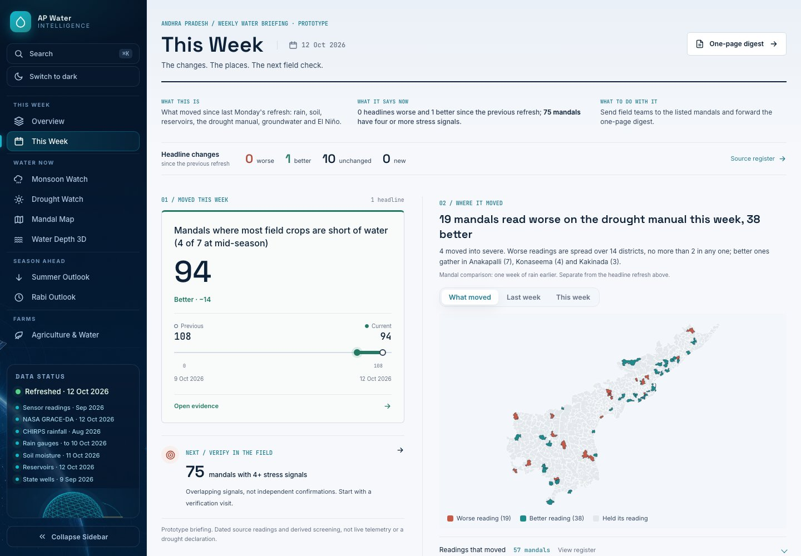
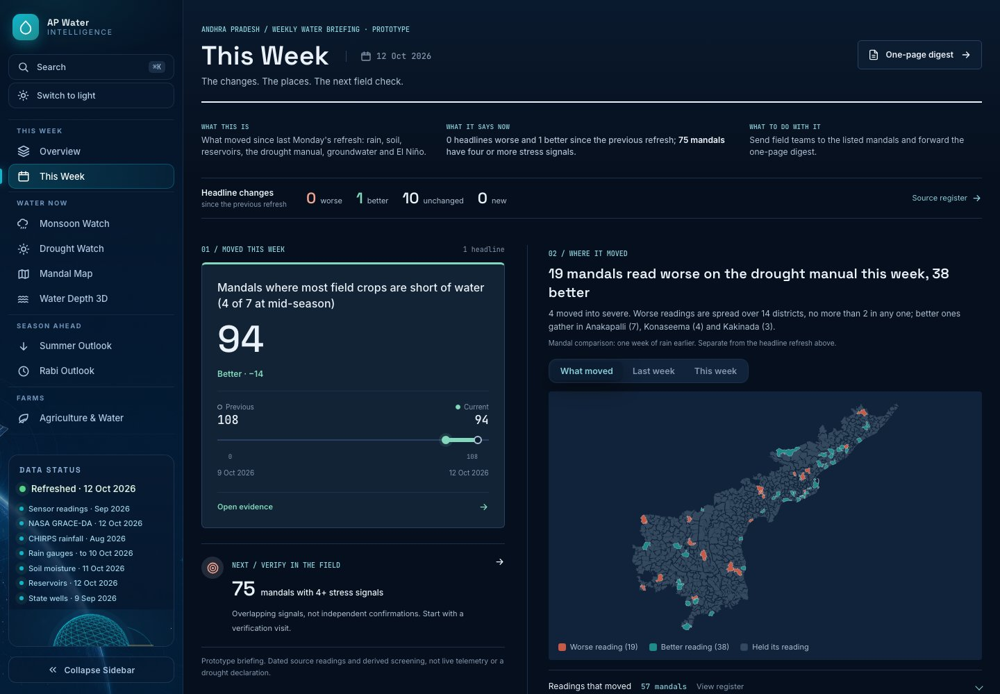
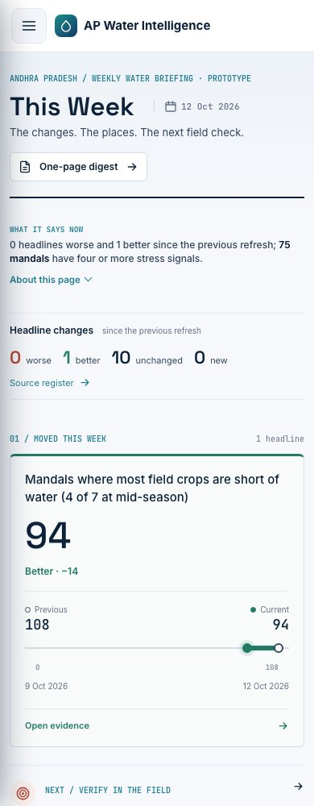

# This Week redesign

Replaces the repeated headline-card grid with a weekly briefing: moved headlines and a two-snapshot comparison, a paired AP movement map, a field-verification entry point, and a folded register of unchanged readings.

No source datasets or model calculations changed. Headline comparisons use the previous refresh; mandal drought changes use one week of rain earlier. Both bases remain explicit. The comparison graphic contains two recorded values, not an inferred trend.

## Verification

- Production static build: passed (878 routes).
- Python: 467 tests passed.
- Focused Playwright: 39 tests passed, including 320/390/768/1440px, light/dark, map modes, registers and print.
- Screenshot review: desktop and phone, no page-level horizontal overflow.
- Data dates, unchanged-source labels, prototype scope and non-declaration caveats retained.

## Screenshots

